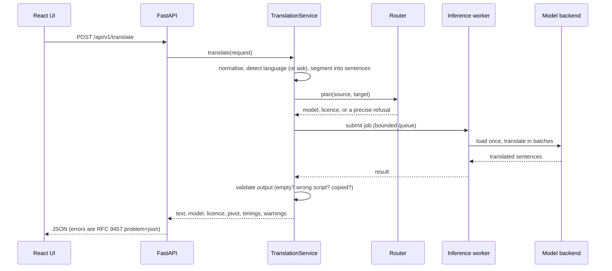

# Multilingual AI Intelligence Platform

Neural machine translation and multilingual NLP for **English and Indian languages** (Telugu, Hindi, Tamil, Kannada,
Malayalam, Bengali, Marathi, Gujarati, Urdu, Punjabi), built so that it never claims more than its evidence supports.

Academic title: *A Neural Machine Translation and NLP Based System for Multi-Lingual Processing*.

> **Status: Milestone 1 of 6.** The foundation and the translation pipeline are built. NLP tasks, document intelligence,
> the evaluation lab and history are planned (see [PROJECT_STATUS.md](PROJECT_STATUS.md)). Nothing in this repository
> pretends to work that does not: every component is marked *verified in the authoring sandbox* or *needs your machine*.

## What is different about it

1. **One source of truth for support.** A language-and-model registry (`backend/app/registry/*.json`) drives routing, the API,
   the UI and the generated page [docs/CAPABILITIES.md](docs/CAPABILITIES.md). Unsupported pairs get a precise error, never a guess.
2. **Licence-aware routing.** NLLB-200 is research-only (CC-BY-NC-4.0); the router blocks it in `commercial` mode and every response
   names the model and its licence.
3. **No silent pivot.** If no model translates A to B directly, the API says so and offers a two-step translation through English
   only when you agree; the result discloses both legs.
4. **Honest language detection.** Script evidence plus abstention: Telugu script means Telugu, but Devanagari text is
   "Hindi or Marathi?" and the user is asked. No fake confidence numbers anywhere.
5. **Safe by construction.** One inference worker with a bounded queue (the event loop never runs a model), pinned model revisions,
   remote model code only after a human reviews a specific commit, offline-by-default model loading, and logs that cannot contain user text.

## Quick start (Windows, CPU only)

```powershell
# 1. one-time tools: Python 3.12 (via uv) and Node.js LTS
powershell -ExecutionPolicy ByPass -c "irm https://astral.sh/uv/install.ps1 | iex"

# 2. backend
cd backend
uv sync --extra ml                       # installs CPU-only PyTorch + Transformers
cd ..
uv run --project backend python scripts/verify_environment.py     # what is installed, what is missing
# Uses the checked-in models.lock.json; do not regenerate pins unless intentionally updating model revisions.
uv run --project backend python scripts/download_models.py --model nllb-200-distilled-600m    # tells you the size, then asks

# 3. check real inference before opening the UI
uv run --project backend python scripts/smoke_translate.py

# 4. run
cd frontend && npm install && cd ..
powershell -File scripts/dev.ps1         # API on :8000, UI on :5173
```

Full instructions, Linux/macOS notes and troubleshooting: [docs/INSTALLATION.md](docs/INSTALLATION.md).

## How a translation request flows



## Layout

```text
backend/app/
  text/         normalisation, script profiling, sentence segmentation, chunking (pure Python)
  domain/       language and model types, registry loader
  detection/    script-based language detection that abstains
  translation/  router, pipeline service, model backends (NLLB, mBART-50, IndicTrans2)
  inference/    single-worker executor, model manager, hardware info, Hub cache checks
  api/          FastAPI adapter: routes, schemas, errors, middleware
  db/           SQLAlchemy models and history repository (text stored only with consent)
  registry/     languages.json, models.json (+ models.lock.json written by scripts/pin_models.py)
frontend/       React + TypeScript + Vite + Tailwind CSS v4
scripts/        environment check, model pinning/download/review, smoke test, doc generation
docs/           architecture, installation, testing, API, security, limitations, viva Q&A
```

## Documentation

| Read this | For |
|---|---|
| [docs/INSTALLATION.md](docs/INSTALLATION.md) | Setting up and running on Windows, Linux, macOS |
| [docs/ARCHITECTURE.md](docs/ARCHITECTURE.md) and [ARCHITECTURE_DECISIONS.md](ARCHITECTURE_DECISIONS.md) | How it is built and why |
| [docs/CAPABILITIES.md](docs/CAPABILITIES.md) | Generated: which model supports which language pair |
| [docs/MODEL_DOCUMENTATION.md](docs/MODEL_DOCUMENTATION.md) | Model facts with sources and dates |
| [docs/API.md](docs/API.md) | Endpoints, errors, examples |
| [docs/TESTING.md](docs/TESTING.md) | What is tested, how, and what is not yet |
| [SECURITY.md](SECURITY.md) and [docs/LIMITATIONS.md](docs/LIMITATIONS.md) | Threat model and honest limits |
| [docs/VIVA.md](docs/VIVA.md) | Viva and interview questions with answers |
| [PROJECT_STATUS.md](PROJECT_STATUS.md), [CHANGELOG.md](CHANGELOG.md) | Where the project stands |

## Licences

The project's own code is MIT licensed ([LICENSE](LICENSE); replace the copyright holder with your name before publishing).
**Model weights keep their own licences**, for example NLLB-200 is CC-BY-NC-4.0 (research use only). See
[docs/MODEL_DOCUMENTATION.md](docs/MODEL_DOCUMENTATION.md).
