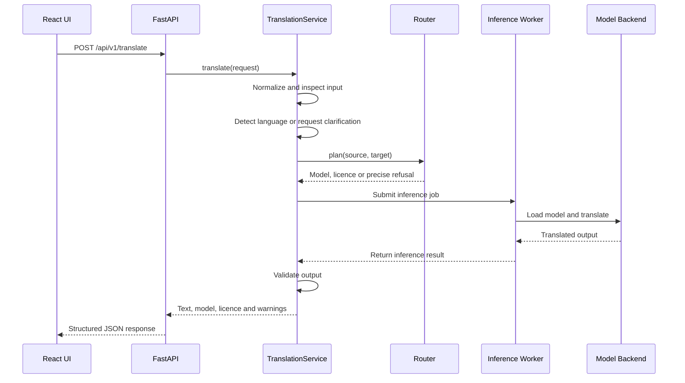

# Multilingual AI Intelligence Platform

Neural machine translation and multilingual NLP for **English and Indian languages**, with a focus on Telugu, Hindi, Tamil, Kannada, Malayalam, Bengali, Marathi, Gujarati, Urdu and Punjabi.

The platform is designed around one principle: **never claim a capability without implementation evidence and verification.**

**Academic project title:** *A Neural Machine Translation and NLP Based System for Multi-Lingual Processing*

**Patent application:** Indian Patent Application No. 202641032355  
**Publication:** IN202641032355 A1 — Indian Patent Journal 13/2026, published 27 March 2026.

> **Project status: Milestone 1 of 6 — Foundation and translation pipeline.**
>
> The local development environment, backend, frontend and NLLB-200 translation pipeline are established. Backend tests, frontend tests and the production build have passed. Real CPU inference has been verified for selected language pairs.
>
> The patent-aligned mBART and mT5 implementations, expanded multilingual NLP capabilities, document intelligence and evaluation lab remain under development or planned.
>
> See [PROJECT_STATUS.md](PROJECT_STATUS.md) and [PATENT_IMPLEMENTATION_TRACEABILITY.md](docs/PATENT_IMPLEMENTATION_TRACEABILITY.md).
>
> Implementation status and verification evidence are documented separately. Planned capabilities are not presented as completed features.

---

## 1. Project vision

The objective is to develop a unified multilingual AI platform that combines neural machine translation with multilingual natural language processing.

The system is intended to evolve through six development milestones:

1. **Foundation:** Architecture, backend, frontend, model registry and translation pipeline.
2. **Patent alignment:** Implement and validate the mBART translation and mT5 multilingual NLP components described in the published patent application.
3. **Advanced translation:** Context-aware translation, language detection, code-switching, domain terminology and intelligent model routing.
4. **Multilingual NLP:** Sentiment analysis, named entity recognition, classification, summarization, keyword extraction and question answering.
5. **Cross-lingual intelligence:** Multilingual retrieval, semantic search, evidence-linked responses and evaluation tools.
6. **Production and multimodal expansion:** Document processing, OCR, speech capabilities, security, scalability, deployment and observability.

These are development objectives, not claims that all six milestones are already complete.

## 2. What makes the architecture different

1. **One source of truth for language and model support.**  
   A language-and-model registry (`backend/app/registry/`) is used to describe supported capabilities and guide routing, API behavior and the user interface. See [docs/CAPABILITIES.md](docs/CAPABILITIES.md).

2. **Licence-aware model routing.**  
   NLLB-200 is licensed under CC-BY-NC-4.0. Its non-commercial restriction must be respected. Model licence information is documented and considered by the routing system.

3. **No silent translation pivot.**  
   If a direct translation route is unavailable, the system must disclose that limitation. A two-step route through an intermediate language must only be used when explicitly permitted and must disclose both translation legs.

4. **Honest language detection.**  
   Script-based evidence is used where possible. Ambiguous text must not be assigned an unsupported language with fabricated confidence. For example, Devanagari text may require clarification between Hindi and Marathi.

5. **Controlled model inference.**  
   The architecture uses a bounded inference queue and a dedicated worker to prevent model execution from blocking the API event loop.

6. **Reproducible model configuration.**  
   Model revisions are pinned in the checked-in `models.lock.json`. Changes to model revisions require deliberate review.

7. **Privacy-conscious design.**  
   User text should not appear in application logs. Translation history must respect user consent and documented retention rules.

8. **Evidence-based development.**  
   Every capability must be classified as implemented, tested, verified, in progress, planned or a proposed extension.

## 3. Patent foundation and relationship to the platform

The published patent application describes a multilingual system integrating:

- **mBART:** A multilingual sequence-to-sequence Transformer architecture for machine translation.
- **mT5:** A multilingual text-to-text framework for downstream NLP tasks.
- Language identification and input preprocessing.
- Tokenization, normalization and text cleaning.
- Neural translation using Transformer encoder-decoder architecture and attention.
- Contextual text generation and post-processing.
- Multilingual NLP capabilities such as sentiment analysis, named entity recognition, classification, keyword extraction and summarization.
- Integration and deployment possibilities involving APIs, enterprise systems and other applications.

The patent abstract also mentions question answering. Its implementation and verification are tracked separately.

**Important distinction:** The published application is not a granted patent. The software repository is an independently developed implementation effort based on the project requirements and available patent materials. It must not be represented as proof that every patent-described capability has already been implemented.

The current NLLB-200 backend is an additional translation implementation. It is not one of the two model families specifically named in the patent abstract.

See [Patent-to-Implementation Traceability](docs/PATENT_IMPLEMENTATION_TRACEABILITY.md) for the detailed mapping between patent material, software modules, tests and future work.

## 4. Current implementation

### Verified foundation

- Python backend using FastAPI.
- React and TypeScript frontend using Vite.
- Translation API and translation service architecture.
- Language and model registry.
- Model revision pinning.
- CPU-based NLLB-200 distilled 600M inference.
- Translation smoke tests for selected language pairs.
- Controlled inference worker architecture.
- Environment verification and model download scripts.
- Backend and frontend automated tests.

### Verification evidence recorded for Milestone 1

| Area | Recorded result |
|---|---|
| Backend automated tests | 162 passed |
| Frontend automated tests | 25 passed |
| Frontend production build | Passed |
| NLLB-200 CPU inference | Verified for selected language pairs |
| Local backend | Started successfully |
| Local frontend | Started successfully |

These results describe the recorded Milestone 1 verification. They do not imply that every language pair, model, feature or deployment configuration has been validated.

### Model implementation status

| Model or component | Status |
|---|---|
| NLLB-200 distilled 600M | Local inference verified |
| mBART | Patent-aligned implementation and validation pending |
| mT5 | Patent-aligned NLP implementation and validation pending |
| IndicTrans2 | Not claimed as verified |
| Other model backends | Subject to implementation and testing |

**Model licence note:** NLLB-200 uses CC-BY-NC-4.0. It must not be used for commercial purposes without appropriate licensing permission. Other models, datasets and tokenizers retain their own licences and conditions.

## 5. Language support

The platform targets English and Indian languages, including:

- English
- Telugu
- Hindi
- Tamil
- Kannada
- Malayalam
- Bengali
- Marathi
- Gujarati
- Urdu
- Punjabi

This is the project's target language scope, not a claim that every language pair is currently supported.

Actual translation availability must be determined by the checked-in language registry, model configuration and verified inference results.

Unsupported language pairs must return a clear limitation rather than silently producing an unreliable result.

See [docs/CAPABILITIES.md](docs/CAPABILITIES.md).

## 6. Quick start — Windows (CPU)

### Prerequisites

- Windows 10 or Windows 11.
- Python 3.12.
- `uv` Python package manager.
- Node.js 20.19 or newer.
- npm.

### Install uv

```powershell
powershell -ExecutionPolicy ByPass -c "irm https://astral.sh/uv/install.ps1 | iex"
```

Restart PowerShell if required.

### Install backend dependencies

```powershell
cd backend
uv sync --extra ml
cd ..
```

### Verify the environment

```powershell
uv run --project backend python scripts/verify_environment.py
```

### Download the translation model

The repository uses the checked-in `models.lock.json`. Do not regenerate model pins unless intentionally updating and reviewing model revisions.

```powershell
uv run --project backend python scripts/download_models.py --model nllb-200-distilled-600m
```

The download script reports model requirements and requests confirmation.

### Test actual model inference

```powershell
uv run --project backend python scripts/smoke_translate.py
```

This step checks real model inference rather than only checking whether the application starts.

### Install frontend dependencies

```powershell
cd frontend
npm install
cd ..
```

### Start the application

```powershell
powershell -File scripts/dev.ps1
```

The development services use:

- Backend API: `http://127.0.0.1:8000`
- Frontend UI: `http://localhost:5173`

For complete instructions, troubleshooting and Linux/macOS guidance, see [docs/INSTALLATION.md](docs/INSTALLATION.md).

## 7. Translation request architecture

The intended translation request flow is:



This diagram describes the intended application architecture. Individual stages must be checked against their implementation and test evidence.

## 8. Repository structure

```text
multilingual-ai-platform/
|
|-- backend/
|   |-- app/
|   |   |-- text/          Text normalization and segmentation
|   |   |-- domain/        Language and model domain types
|   |   |-- detection/     Language and script detection
|   |   |-- translation/   Translation service and routing
|   |   |-- inference/     Model loading and inference execution
|   |   |-- api/           FastAPI routes, schemas and middleware
|   |   |-- db/            Database models and history repository
|   |   |-- registry/      Language and model configuration
|   |
|   |-- tests/
|   |-- scripts/
|   |-- reports/
|
|-- frontend/
|   |-- src/
|   |-- public/
|   |-- tests/
|
|-- scripts/
|   |-- Environment and development helpers
|
|-- docs/
|   |-- ARCHITECTURE.md
|   |-- INSTALLATION.md
|   |-- CAPABILITIES.md
|   |-- MODEL_DOCUMENTATION.md
|   |-- API.md
|   |-- TESTING.md
|   |-- SECURITY.md
|   |-- LIMITATIONS.md
|   |-- VIVA.md
|   |-- PATENT_IMPLEMENTATION_TRACEABILITY.md
|
|-- PROJECT_STATUS.md
|-- CHANGELOG.md
|-- README.md
|-- LICENSE
|-- SECURITY.md
|-- .gitignore
```

The layout is a high-level project guide. Refer to the actual repository for the current file and directory contents.

## 9. Development roadmap

### Milestone 1 — Foundation and translation pipeline

- Repository and development environment.
- Backend and frontend foundation.
- Translation API.
- Model registry and revision pinning.
- NLLB-200 local CPU inference.
- Automated tests and smoke testing.

**Status:** Foundation established; selected translation paths verified.

### Milestone 2 — Patent-aligned model implementation

- Implement and validate mBART translation integration.
- Implement and validate mT5 text-to-text NLP integration.
- Connect model capabilities to the language and model registry.
- Add model-specific tests and evaluation evidence.
- Document the relationship to the published patent.

**Status:** Planned / under development.

### Milestone 3 — Advanced translation intelligence

- Context-aware translation.
- Long-document and sentence-context handling.
- Domain terminology and glossary management.
- Code-switching analysis.
- Intelligent model routing.
- Translation quality checks.
- Consent-based translation history.

**Status:** Planned.

### Milestone 4 — Multilingual NLP

- Sentiment analysis.
- Named entity recognition.
- Text classification.
- Keyword extraction.
- Multilingual summarization.
- Question answering.
- Native-language and translated-text processing.

**Status:** Planned.

### Milestone 5 — Cross-lingual intelligence and evaluation

- Cross-language semantic search.
- Multilingual retrieval and retrieval-augmented generation.
- Evidence-linked answers.
- Translation model comparison.
- BLEU and chrF++ evaluation.
- Human evaluation workflows.
- Quality reports and error analysis.

**Status:** Planned.

### Milestone 6 — Production and multimodal expansion

- PDF and DOCX document processing.
- OCR and image-text processing.
- Speech input and output.
- Authentication and authorization.
- Privacy and data retention controls.
- Performance and load testing.
- Observability and monitoring.
- Cloud, enterprise and edge deployment.

**Status:** Planned. OCR and speech are proposed extensions beyond the explicit flowchart and feature descriptions in the published patent materials.

## 10. Documentation

| Document | Purpose |
|---|---|
| [docs/INSTALLATION.md](docs/INSTALLATION.md) | Setup and troubleshooting |
| [docs/ARCHITECTURE.md](docs/ARCHITECTURE.md) | System architecture |
| [ARCHITECTURE_DECISIONS.md](ARCHITECTURE_DECISIONS.md) | Architecture decisions |
| [docs/CAPABILITIES.md](docs/CAPABILITIES.md) | Language and model capability information |
| [docs/MODEL_DOCUMENTATION.md](docs/MODEL_DOCUMENTATION.md) | Model details, sources and licences |
| [docs/API.md](docs/API.md) | API endpoints and examples |
| [docs/TESTING.md](docs/TESTING.md) | Test strategy and evidence |
| [SECURITY.md](SECURITY.md) | Security reporting and policy |
| [docs/LIMITATIONS.md](docs/LIMITATIONS.md) | Known limitations |
| [docs/VIVA.md](docs/VIVA.md) | Academic viva preparation |
| [PROJECT_STATUS.md](PROJECT_STATUS.md) | Current milestone and progress |
| [CHANGELOG.md](CHANGELOG.md) | Project changes |
| [docs/PATENT_IMPLEMENTATION_TRACEABILITY.md](docs/PATENT_IMPLEMENTATION_TRACEABILITY.md) | Patent-to-software mapping and roadmap |

## 11. Testing and evidence policy

The project follows an evidence-first development process.

A feature is not considered verified merely because:

- A UI button exists.
- An API endpoint returns a response.
- A model is listed in a configuration file.
- A dependency is installed.
- A code path has been written.

Verification requires appropriate evidence, such as:

- Automated tests.
- Real model inference.
- Supported language-pair checks.
- Error and edge-case tests.
- Performance measurements where relevant.
- Reproducible execution instructions.

Test results must identify what was tested, the environment, the date and any limitations.

## 12. Intellectual property and licensing

This repository is an AI-assisted software implementation effort associated with an academic project and a published Indian patent application.

The patent application is a team-associated application. The published application identifies multiple inventors. This repository does not claim sole inventorship, exclusive ownership or a granted patent.

The original academic implementation and the present software implementation must not be represented as identical source code. Development of this repository has involved reconstruction from available requirements and functional understanding, with AI-assisted coding and testing.

The project's own code is distributed under the MIT License, subject to the actual terms in [LICENSE](LICENSE).

**Third-party models, model weights, tokenizers and datasets retain their respective licences.** In particular, NLLB-200's CC-BY-NC-4.0 licence imposes non-commercial-use restrictions.

Do not assume that the project's MIT licence overrides third-party model or dataset licences.

See [docs/MODEL_DOCUMENTATION.md](docs/MODEL_DOCUMENTATION.md) for model-specific information.

## 13. Core development principle

The long-term objective is not simply to build a translation website or add disconnected AI features.

It is to develop a coherent multilingual AI intelligence platform in which:

- Translation and NLP share a consistent language-processing foundation.
- Models are selected based on actual capabilities and licence constraints.
- Language support is explicit and verifiable.
- Outputs are evaluated rather than blindly trusted.
- Users receive transparent limitations and error messages.
- Privacy, reproducibility and maintainability are part of the architecture.
- Every new capability is connected to a documented requirement and tested implementation.

**Build carefully. Verify honestly. Extend intelligently.**