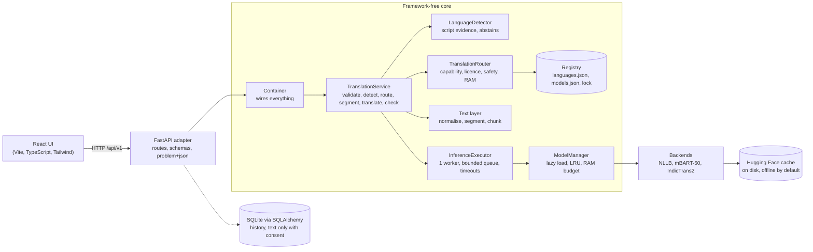
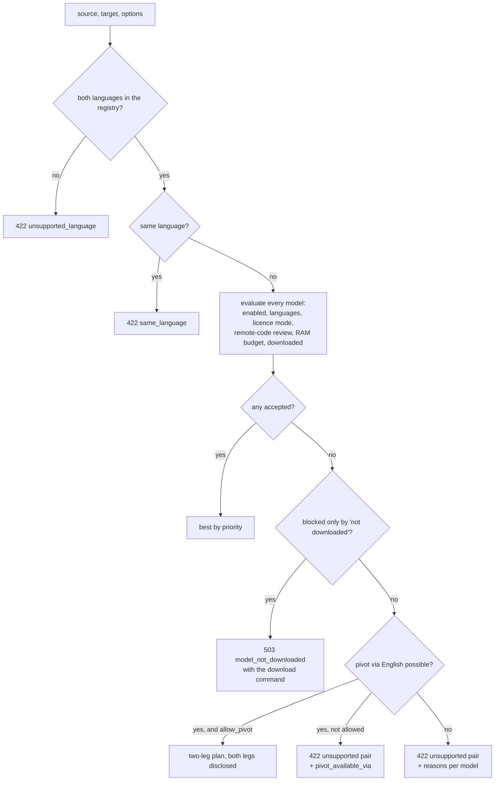

# Architecture

## The idea in one paragraph

The platform is a **framework-free core** (text handling, registry, routing, pipeline, worker, model management) with thin
**adapters** around it (FastAPI for HTTP, SQLAlchemy for storage, Hugging Face Transformers for model engines, React for the UI).
The core imports only the Python standard library, so its 160+ tests run anywhere, and swapping an adapter never touches the logic.

## Components

| Layer | Package | Depends on | Tested here with |
|---|---|---|---|
| Text | `app/text` | standard library | unit + fuzz tests |
| Domain | `app/domain`, `app/detection` | standard library | unit tests |
| Pipeline | `app/translation` (router, service) | domain, text, inference | unit tests with fake backends |
| Inference | `app/inference` | standard library, psutil | unit + concurrency tests |
| Engines | `app/translation/backends` | torch, transformers (lazy imports) | not run here (no network) |
| HTTP | `app/api`, `app/main.py` | FastAPI, pydantic | stub glue check here; `tests/api` on your machine |
| Storage | `app/db` | SQLAlchemy, Alembic | `tests/integration` on your machine |

## One translation, step by step

1. **Normalise** (NFC; keep ZWJ/ZWNJ; drop invisible junk). The original text is kept separately.
2. **Validate**: not empty, within `MLAI_MAX_INPUT_CHARS`.
3. **Source language**: given by the user, or detected from script evidence; if the evidence is not enough, the API returns
   `language_ambiguous` with the candidates instead of guessing.
4. **Route**: every registered model is evaluated and given reasons (disabled, language not covered, licence not allowed, remote code
   not reviewed, over the RAM budget, weights not downloaded). The best accepted model by priority wins.
5. **Segment** into sentences with exact following whitespace, so paragraphs survive.
6. **Plan units and batches** from model-specific token limits; very long sentences are split at clauses, then words, and the split is disclosed.
7. **Translate** on the single inference worker; batches are checked for cancellation between runs.
8. **Validate output**: empty output is an error; wrong script, copied sentences and length outliers are warnings.
9. **Report**: translation, model ids and revisions, licence, device, timings, warnings, pivot disclosure. No confidence score.

## Why one inference worker

Model inference is heavy and blocking. Running it inside an async request handler would freeze the whole server, and running it
in several threads or processes would load several copies of a multi-gigabyte model. So exactly one worker thread owns all model work.
The queue is bounded: when it is full the API answers `503` with `Retry-After` immediately. A request that times out or is cancelled
while waiting never runs; a running job checks a cancel token between batches.

## Extension points

| To add | Do this |
|---|---|
| A language | Add it to `languages.json` and to the model code sets in `models.json`; run `python scripts/generate_capability_docs.py`; run `scripts/verify_language_codes.py` after downloading the model |
| A model for an existing family | Add an entry to `models.json` (licence, languages, parameters, evidence); pin it with `scripts/pin_models.py` |
| A new model family | Write a backend class implementing `TranslationBackend` and register it in `FAMILIES` |
| A new NLP task | Add a service in the core (same pattern: registry capability, router rule, service, API route); Milestone 4 does this for summarisation, sentiment, NER, classification and question answering |
